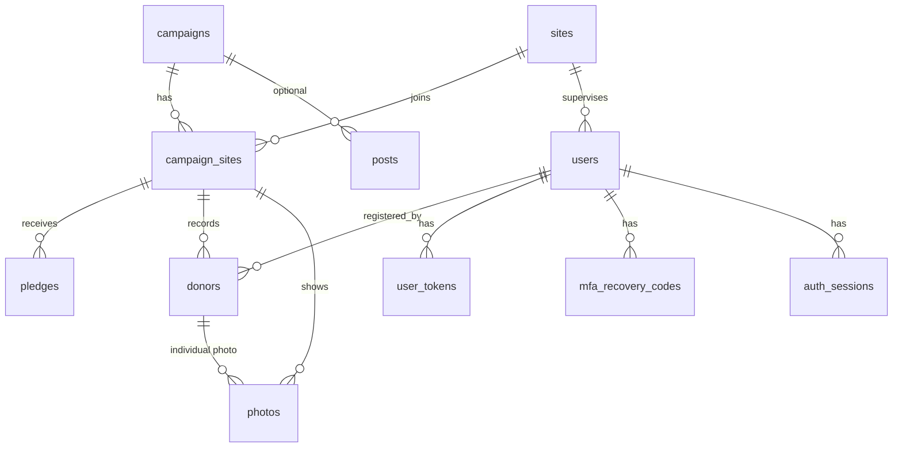

# 02 - تصميم قاعدة البيانات (PostgreSQL + SQLAlchemy + Alembic)

> **النسخة:** 2.1 (محدّثة ومتزامنة مع `06` v1.1 و `11-decisions.md` v1.1)
> **الغرض:** تعريف الجداول والقيود والفهارس والهجرات، بحيث تُترجم مباشرة إلى نماذج SQLAlchemy وسكربتات Alembic.
> **مكان الملف:** `docs/02-database.md`
> **يعتمد على:** `01-foundation.md`، وقرارات `11-decisions.md`
> **يرتبط بـ:** `06-business-rules.md` (القواعد v1.1)، `03-auth-permissions.md` (الصلاحيات)، `07-test-cases.md` (v1.1)

---

## 1. ما الذي تغيّر عن النسخة السابقة (Supabase)

| كان | أصبح |
|---|---|
| سياسات RLS على كل جدول | **حُذفت.** الصلاحيات تُفرض في طبقة الكود (انظر `03`) وتُغطى باختبارات |
| `auth.users` الجاهز | جدول `users` خاص بنا، مع جداول للدعوات وإعادة التعيين ورموز MFA |
| مشغّلات (triggers) للمنطق | **لا مشغّلات منطقية.** المنطق في طبقة الخدمات (`06`)، والقاعدة تحتفظ بالقيود فقط |
| دوال RPC | استعلامات مشتقة في طبقة المستودعات (القسم 9) |
| pg_cron | أمر CLI يُشغَّل من cron (القسم 11) |
| أنواع Enum أصلية | **VARCHAR + قيد CHECK** (أسهل في الهجرات، القسم 3) |

**ما بقي كما هو:** الجداول الأساسية، المفاتيح المركّبة، قيود الموافقات، فصل التعهد عن المتبرع، الإخفاء بعد سنة.

---

## 2. مبادئ التصميم

1. **القيود في القاعدة أولًا.** CHECK وFK وUNIQUE هي خط الدفاع الأخير، وتتكرر في Pydantic لتجربة أفضل.
2. **لا منطق خفي في القاعدة.** لا مشغّلات تغيّر البيانات؛ كل ما يغيّر حالة يمر عبر خدمة قابلة للاختبار.
3. **فصل التعهد عن المتبرع** بلا ربط إلزامي.
4. **التجميع استعلامات لا جداول** (الأبطال، الترتيب، العدّادات، الطوارئ).
5. **الحذف الصلب (hard delete)** لا الناعم، لأن الخصوصية تتطلب محو البيانات فعليًا.
6. **إخفاء الهوية بدل حذف المتبرعين** بعد سنة، لتبقى الأرقام التاريخية.
7. **البساطة:** لا جداول أو أعمدة "للاحتياط". كل عمود له سبب مذكور.

---

## 3. اتفاقيات عامة

| البند | الاتفاق |
|---|---|
| **الإصدار** | PostgreSQL 15 أو أحدث |
| **أسماء الجداول** | جمع، `snake_case` إنجليزي (`donors`) |
| **أسماء النماذج في Python** | مفرد، `PascalCase` (`Donor`) |
| **المعرّفات** | `UUID` (القيمة الافتراضية `gen_random_uuid()`) ما عدا سجلات السجل (`BIGINT` بتسلسل تلقائي) |
| **المتبرع** | يُسمح للعميل بتوليد `id` بنفسه (لمنع التكرار عند إعادة الإرسال) |
| **الوقت** | `TIMESTAMPTZ` دائمًا، يُخزَّن بتوقيت UTC |
| **التواريخ الحرة** | `DATE` لتاريخ الحملة فقط |
| **الحالات والأدوار** | **`VARCHAR` + قيد `CHECK`** وليس نوع Enum أصلي (تعديل قيم Enum في الهجرات مؤلم). في SQLAlchemy: `Enum(..., native_enum=False)` مع `create_constraint=True` |
| **النصوص** | `TEXT` مع قيود طول `CHECK` حيث يلزم |
| **منطقية** | `BOOLEAN NOT NULL DEFAULT false` |
| **JSON** | `JSONB` للأرقام المجمّدة وتفاصيل التدقيق فقط |
| **أسماء القيود** | اتفاقية تسمية موحدة في `MetaData(naming_convention=...)` ليعمل Alembic بثبات: `pk_`, `fk_`, `uq_`, `ck_`, `ix_` |
| **الحقول المشتركة** | `created_at`، و`updated_at` (يُحدَّث من SQLAlchemy `onupdate`) حيث يلزم |

**القيم الثابتة:**

| الحقل | القيم |
|---|---|
| `campaigns.status` | `upcoming`، `live`، `ended` |
| `users.role` | `supervisor`، `admin` |
| `donors.status` | `attended`، `donated` |
| `donors.blood_type` | `A+` `A-` `B+` `B-` `AB+` `AB-` `O+` `O-` |
| `photos.kind` | `general`، `individual` |
| `user_tokens.purpose` | `invite`، `password_reset` |

---

## 4. مخطط العلاقات (ER)



---

## 5. الجداول (قاموس البيانات)

> الرمز: **PK** مفتاح أساسي، **FK** مفتاح خارجي، **NN** إلزامي (NOT NULL)، **UQ** فريد.

### 5.1 `campaigns` — الحملات (والمدوّنة)

| العمود | النوع | قيود | ملاحظة |
|---|---|---|---|
| `id` | UUID | PK | |
| `slug` | TEXT | NN، UQ، `CHECK slug ~ '^[a-z0-9]+(-[a-z0-9]+)*$'` | رابط لاتيني مختصر |
| `title` | TEXT | NN | |
| `summary` | TEXT | | مقتطف للبطاقات |
| `content` | TEXT | | Markdown (يُنظَّف عند العرض) |
| `cover_url` | TEXT | | |
| `campaign_date` | DATE | NN | |
| `status` | VARCHAR | NN، `upcoming` افتراضيًا، CHECK على القيم | |
| `is_published` | BOOLEAN | NN، false | |
| `is_current` | BOOLEAN | NN، false | |
| `final_stats` | JSONB | | تُجمَّد عند الإنهاء (البنية في 5.12) |
| `ended_at` | TIMESTAMPTZ | | |
| `personal_data_purged_at` | TIMESTAMPTZ | | يُملأ بعد إخفاء الهوية |
| `created_at`، `updated_at` | TIMESTAMPTZ | NN | |

**فهرس:** `UNIQUE (is_current) WHERE is_current` ← حملة حالية واحدة فقط.

### 5.2 `sites` — المواقع = النوادي (دائمة)

| العمود | النوع | قيود | ملاحظة |
|---|---|---|---|
| `id` | UUID | PK | |
| `name` | TEXT | NN | |
| `logo_key` | TEXT | | مفتاح ملف الشعار في التخزين |
| `address` | TEXT | NN | |
| `map_url` | TEXT | | رابط Google Maps |
| `latitude`، `longitude` | NUMERIC(9,6) | | اختياري |
| `description` | TEXT | | |
| `is_active` | BOOLEAN | NN، true | التعطيل يخفي ولا يحذف |
| `created_at`، `updated_at` | TIMESTAMPTZ | NN | |

### 5.3 `campaign_sites` — مشاركة موقع في حملة

| العمود | النوع | قيود | ملاحظة |
|---|---|---|---|
| `campaign_id` | UUID | **PK (مركّب)**، FK → `campaigns` ON DELETE CASCADE | |
| `site_id` | UUID | **PK (مركّب)**، FK → `sites` ON DELETE RESTRICT | |
| `start_time` | TIME | | وقت بدء التجميع |
| `end_time` | TIME | | وقت نهايته |
| `supervisors_text` | TEXT | | أسماء فريق الإشراف للعرض العام (لا تُربط بجدول المستخدمين) |
| `notes` | TEXT | | |

**قيد:** `CHECK (end_time IS NULL OR start_time IS NULL OR end_time > start_time)`.

**فائدته:** يجعل النادي دائمًا عبر الحملات، ويحمل ما يتغير كل مرة. وهو **هدف المفاتيح الخارجية المركّبة** في `pledges` و`donors` و`photos`.

### 5.4 `users` — المشرفون والأدمن

| العمود | النوع | قيود | ملاحظة |
|---|---|---|---|
| `id` | UUID | PK | |
| `email` | TEXT | NN | يُخزَّن بحروف صغيرة |
| `full_name` | TEXT | NN | |
| `password_hash` | TEXT | | قيمة argon2، فارغة قبل قبول الدعوة |
| `role` | VARCHAR | NN، CHECK على القيم | |
| `site_id` | UUID | FK → `sites` ON DELETE SET NULL | للمشرف فقط |
| `is_active` | BOOLEAN | NN، true | |
| `must_change_password` | BOOLEAN | NN، false | |
| `totp_secret_enc` | TEXT | | سر TOTP **مشفّر** (للأدمن) |
| `totp_enabled` | BOOLEAN | NN، false | |
| `totp_last_used_step` | INTEGER | | رقم خطوة الوقت لآخر رمز TOTP استُعمل بنجاح (BR-AUTH-09 لمنع إعادة الاستعمال) |
| `failed_login_count` | INTEGER | NN، 0 | |
| `locked_until` | TIMESTAMPTZ | | قفل مؤقت بعد المحاولات الفاشلة |
| `last_login_at` | TIMESTAMPTZ | | |
| `created_at`، `updated_at` | TIMESTAMPTZ | NN | |

**قيود وفهارس:**
- `UNIQUE (lower(email))` فهرس وظيفي.
- `CHECK (role = 'admin' OR site_id IS NOT NULL)` ← المشرف يحتاج موقعًا.
- لا حقل يخزّن كلمة مرور نصية أبدًا.

### 5.5 `user_tokens` — رموز الدعوة وإعادة التعيين

| العمود | النوع | قيود | ملاحظة |
|---|---|---|---|
| `id` | UUID | PK | |
| `user_id` | UUID | NN، FK → `users` ON DELETE CASCADE | |
| `purpose` | VARCHAR | NN، CHECK (`invite`، `password_reset`) | |
| `token_hash` | TEXT | NN، UQ | **يُخزَّن الهاش لا الرمز نفسه** |
| `expires_at` | TIMESTAMPTZ | NN | الدعوة مثلًا 72 ساعة، وإعادة التعيين ساعة |
| `used_at` | TIMESTAMPTZ | | يُملأ عند الاستعمال (استعمال واحد فقط) |
| `created_at` | TIMESTAMPTZ | NN | |

### 5.6 `mfa_recovery_codes` — أكواد استرداد المصادقة الثنائية

| العمود | النوع | قيود |
|---|---|---|
| `id` | UUID | PK |
| `user_id` | UUID | NN، FK → `users` ON DELETE CASCADE |
| `code_hash` | TEXT | NN |
| `used_at` | TIMESTAMPTZ | |

### 5.7 `auth_sessions` — الجلسات *(مشروطة بقرار D-07)*

> **تُنشأ فقط إن اعتُمدت الجلسات من جهة الخادم.** إن اعتُمد JWT بلا حالة، يُحذف هذا الجدول. الأفضل في هذا المشروع (حساب يُعطَّل فورًا) هو الجلسات من الخادم.

| العمود | النوع | قيود | ملاحظة |
|---|---|---|---|
| `id` | TEXT | PK | **هاش** معرّف الجلسة |
| `user_id` | UUID | NN، FK → `users` ON DELETE CASCADE | |
| `created_at` | TIMESTAMPTZ | NN | |
| `last_seen_at` | TIMESTAMPTZ | NN | |
| `expires_at` | TIMESTAMPTZ | NN | |
| `revoked_at` | TIMESTAMPTZ | | |
| `mfa_verified` | BOOLEAN | NN، false | |
| `ip_hash` | TEXT | | |
| `user_agent` | TEXT | | مقتطع |

### 5.8 `pledges` — نيّات الحضور (شكلية)

| العمود | النوع | قيود | ملاحظة |
|---|---|---|---|
| `id` | UUID | PK | |
| `campaign_id` | UUID | NN | |
| `site_id` | UUID | NN | |
| `first_name` | TEXT | NN، `CHECK char_length BETWEEN 2 AND 40` | |
| `phone` | TEXT | `CHECK phone ~ '^\+?[0-9]{8,15}$'` | اختياري |
| `created_at` | TIMESTAMPTZ | NN | |

**قيود:**
- `FOREIGN KEY (campaign_id, site_id) → campaign_sites(campaign_id, site_id) ON DELETE CASCADE`.
- **فهرس فريد جزئي:** `UNIQUE (campaign_id, site_id, phone) WHERE phone IS NOT NULL`.

### 5.9 `donors` — المتبرعون الفعليون

| العمود | النوع | قيود | ملاحظة |
|---|---|---|---|
| `id` | UUID | PK | **يُسمح للعميل بتوليده** |
| `campaign_id` | UUID | NN | |
| `site_id` | UUID | NN | |
| `first_name` | TEXT | NN، طول 1–40 | |
| `last_name` | TEXT | طول ≤ 40 | |
| `phone` | TEXT | `CHECK phone ~ '^\+?[0-9]{8,15}$'` | |
| `blood_type` | VARCHAR | CHECK على القيم الثمانية | اختياري |
| `status` | VARCHAR | NN، `attended` افتراضيًا | |
| `consent_keep_phone` | BOOLEAN | NN، false | حفظ الرقم لحملات قادمة |
| `consent_hero_name` | BOOLEAN | NN، false | ظهور الاسم الأول في الأبطال |
| `consent_photo` | BOOLEAN | NN، false | التقاط الصورة ونشرها |
| `consent_public_phone` | BOOLEAN | NN، false | ظهور الرقم للطوارئ |
| `registered_by` | UUID | FK → `users` ON DELETE SET NULL | المشرف المسجِّل |
| `donated_at` | TIMESTAMPTZ | | تُملأ من الخدمة عند `donated` |
| `anonymized_at` | TIMESTAMPTZ | | |
| `created_at`، `updated_at` | TIMESTAMPTZ | NN | |

**قيود:**

| الاسم | التعريف | المعنى |
|---|---|---|
| `fk_donors_campaign_site` | `(campaign_id, site_id) → campaign_sites` ON DELETE RESTRICT | لا متبرع في موقع غير مشارك |
| `ck_donors_status` | `status IN ('attended','donated')` | |
| `ck_donors_phone_needs_consent` | `phone IS NULL OR consent_keep_phone OR consent_public_phone` | لا هاتف دون موافقة |
| `ck_donors_public_phone_needs_data` | `NOT consent_public_phone OR (phone IS NOT NULL AND blood_type IS NOT NULL)` | نشر الرقم يتطلب هاتفًا وفصيلة |
| `ck_donors_donated_at` | `(status = 'donated') OR donated_at IS NULL` | وقت التبرع فقط لمن تبرّع |

> **ملاحظة:** نضع `ck_donors_donated_at` لأن الخدمة هي التي تملأ الحقل (لا مشغّل)، والقيد يلتقط أي خطأ برمجي.

### 5.10 `photos` — الصور

| العمود | النوع | قيود | ملاحظة |
|---|---|---|---|
| `id` | UUID | PK | |
| `campaign_id` | UUID | NN | |
| `site_id` | UUID | NN | |
| `storage_key` | TEXT | NN | مفتاح الملف في التخزين |
| `kind` | VARCHAR | NN، `general` افتراضيًا، CHECK | |
| `caption` | TEXT | | |
| `donor_id` | UUID | FK → `donors` ON DELETE CASCADE | للصور الفردية فقط |
| `mime_type` | TEXT | NN | `image/jpeg` / `png` / `webp` |
| `size_bytes` | INTEGER | NN، `> 0` | |
| `uploaded_by` | UUID | FK → `users` ON DELETE SET NULL | |
| `created_at` | TIMESTAMPTZ | NN | |

**قيود:**
- `FOREIGN KEY (campaign_id, site_id) → campaign_sites` ON DELETE RESTRICT.
- `CHECK ((kind = 'individual') = (donor_id IS NOT NULL))`.
- **قاعدة موافقة الصورة الفردية** (`consent_photo = true`) **تُفرض في الخدمة** لأنها تعبر جدولين (انظر `06`) ويغطيها اختبار.

### 5.11 `posts` — منشورات حرة *(اختيارية، حسب القرار D-01)*

| العمود | النوع | قيود |
|---|---|---|
| `id` | UUID | PK |
| `campaign_id` | UUID | FK → `campaigns` ON DELETE SET NULL |
| `slug` | TEXT | NN، UQ، نفس نمط `campaigns.slug` |
| `title` | TEXT | NN |
| `excerpt` | TEXT | |
| `content` | TEXT | Markdown |
| `cover_url` | TEXT | |
| `is_published` | BOOLEAN | NN، false |
| `published_at` | TIMESTAMPTZ | |
| `created_at`، `updated_at` | TIMESTAMPTZ | NN |

**فهرس:** `(published_at DESC) WHERE is_published`.

### 5.12 `audit_log` — سجل التدقيق (إضافة فقط)

| العمود | النوع | قيود | ملاحظة |
|---|---|---|---|
| `id` | BIGINT | PK، تسلسل تلقائي | |
| `at` | TIMESTAMPTZ | NN | |
| `actor_user_id` | UUID | FK → `users` ON DELETE SET NULL | فارغ للنظام |
| `action` | TEXT | NN | `donor.create`، `donor.status_change`، `campaign.end`... |
| `entity_type` | TEXT | NN | |
| `entity_id` | UUID | | |
| `details` | JSONB | | **بلا هواتف ولا أسماء ولا فصائل** |

**حماية:** يُمنح مستخدم التطبيق صلاحية `INSERT` و`SELECT` فقط على هذا الجدول (لا تعديل ولا حذف).

### 5.13 `phone_reveal_log` — تحديد معدل كشف الأرقام

| العمود | النوع | قيود |
|---|---|---|
| `id` | BIGINT | PK، تسلسل |
| `ip_hash` | TEXT | NN |
| `donor_id` | UUID | **بلا FK** (قد يُحذف المتبرع) |
| `created_at` | TIMESTAMPTZ | NN |

**فهرس:** `(ip_hash, created_at)`. تُحذف السجلات الأقدم من 7 أيام.

### 5.14 `file_deletion_queue` — ملفات تنتظر الحذف من التخزين

| العمود | النوع | قيود |
|---|---|---|
| `id` | BIGINT | PK، تسلسل |
| `storage_key` | TEXT | NN |
| `created_at` | TIMESTAMPTZ | NN |
| `deleted_at` | TIMESTAMPTZ |  |

تُملأ **من الخدمة** عند حذف أي صورة (لا مشغّل). وتتحدد آلية الحذف الفعلي بحسب قرار التخزين (D-06).

### 5.15 `rate_limit_events` — أحداث تحديد المعدل *(اختيارية / احتياطية)*

> محدد المعدل الأساسي يعمل في الذاكرة (قرار D-30) لكون الخادم يعمل بعملية واحدة خلف Caddy. يُستخدم هذا الجدول اختياريًا عند الحاجة لتسجيل واسترجاع أحداث التجاوز المستمرة أو عبر إعادة تشغيل الخادم.

| العمود | النوع | قيود | ملاحظة |
|---|---|---|---|
| `id` | BIGINT | PK، تسلسل تلقائي | |
| `key_hash` | TEXT | NN | هاش مملَّح للعنوان أو المعرّف (لا IP خام) |
| `action` | VARCHAR | NN | مثل `login`، `emergency_reveal`، `pledge` |
| `created_at` | TIMESTAMPTZ | NN | وقت وقوع المحاولة |

**فهرس:** `(key_hash, action, created_at)`. تُحذف السجلات دوريًا مع بقية السجلات المؤقتة.

### 5.16 بنية `campaigns.final_stats`

```json
{
  "pledges": 143,
  "present": 61,
  "donated": 52,
  "heroes": 38,
  "by_site": [
    { "site_id": "…", "name": "نادي الطب أ", "pledges": 70, "present": 30, "donated": 26 }
  ],
  "frozen_at": "2026-11-20T18:00:00Z"
}
```

---

## 6. الفهارس

| الجدول | الفهرس | الغرض |
|---|---|---|
| `campaigns` | `UNIQUE (is_current) WHERE is_current` | حملة حالية واحدة |
| `campaigns` | `(status)` | تصفية الحملات |
| `users` | `UNIQUE (lower(email))` | الدخول |
| `users` | `(site_id)` | مشرفو الموقع |
| `pledges` | `UNIQUE (campaign_id, site_id, phone) WHERE phone IS NOT NULL` | منع التكرار |
| `pledges` | `(campaign_id, site_id)` | العدّ |
| `donors` | `(campaign_id, site_id, status)` | لوحة المشرف والترتيب |
| `donors` | `(blood_type) WHERE consent_public_phone AND status='donated' AND anonymized_at IS NULL` | الطوارئ |
| `donors` | `(site_id, lower(first_name))` | البحث السريع بالاسم *(اختياري)* |
| `photos` | `(campaign_id, site_id)` | المعرض |
| `posts` | `(published_at DESC) WHERE is_published` | قائمة المدوّنة |
| `phone_reveal_log` | `(ip_hash, created_at)` | تحديد المعدل |
| `rate_limit_events` | `(key_hash, action, created_at)` | تحديد المعدل واستعلام النوافذ *(اختياري)* |
| `user_tokens` | `(user_id, purpose)` | بحث الدعوات |
| `auth_sessions` | `(user_id)` | إبطال جلسات المستخدم |

الحجم متوقع صغير (مئات إلى آلاف الصفوف)، فلا حاجة لفهارس إضافية قبل القياس.

---

## 7. الصلاحيات على مستوى قاعدة البيانات

بدل RLS، نستعمل **دورين** في PostgreSQL:

| الدور | الاستعمال | الصلاحيات |
|---|---|---|
| `app_migrator` | تشغيل Alembic فقط | إنشاء/تعديل الجداول |
| `app_user` | التطبيق وقت التشغيل | `SELECT/INSERT/UPDATE/DELETE` على الجداول **دون** DDL |

**استثناءات:**
- `audit_log`: `INSERT` و`SELECT` فقط.
- لا يُستعمل مستخدم superuser في التطبيق أبدًا.
- بيانات اتصال كل دور في متغيرات بيئة منفصلة.

---

## 8. من يملك أي قاعدة (القاعدة أم الخدمة)

| القاعدة | القاعدة (DB) | الخدمة (Python) |
|---|---|---|
| الهاتف يتطلب موافقة | ✅ CHECK | ✅ Pydantic + إفراغ الحقل |
| نشر الرقم يتطلب هاتفًا وفصيلة | ✅ CHECK | ✅ |
| متبرع في موقع مشارك فقط | ✅ FK مركّب | ✅ |
| `donated_at` يتبع الحالة | ✅ CHECK (حماية) | ✅ **تملؤه الخدمة** |
| تعيين `registered_by` | | ✅ من المستخدم الحالي |
| عدم تغيير الموقع/الحملة بعد الإنشاء | | ✅ |
| المشرف يكتب فقط والحملة جارية | | ✅ |
| صورة فردية تتطلب موافقة | | ✅ |
| حملة حالية واحدة | ✅ فهرس فريد جزئي | ✅ تعيين ضمن معاملة واحدة |
| تكرار الهاتف في التعهد | ✅ فهرس فريد | ✅ يعامل كنجاح صامت |
| تحديد معدل الكشف | | ✅ |
| تسجيل التدقيق | | ✅ |

> **القاعدة:** ما أمكن التعبير عنه بقيد على صف واحد أو مفتاح، يُوضع في القاعدة. وما يعبر جداول أو يعتمد على المستخدم الحالي، يُوضع في الخدمة ويُختبر.

---

## 9. الاستعلامات المشتقة (مرجعية)

هذه الاستعلامات تُنفَّذ في طبقة المستودعات (`repositories`). **لا تُخزَّن كجداول.** القواعد الكاملة في `06-business-rules.md`.

**قائمة الأبطال**
```sql
SELECT d.first_name, s.id AS site_id, s.name AS site_name
FROM donors d
JOIN sites s ON s.id = d.site_id
JOIN campaigns c ON c.id = d.campaign_id
WHERE d.campaign_id = :campaign
  AND c.is_published
  AND d.status = 'donated'
  AND d.consent_hero_name
ORDER BY d.donated_at DESC NULLS LAST;
```

**ترتيب النوادي**

```sql
-- 1. ترتيب النوادي للحملة الجارية (حساب حي ومباشر)
SELECT s.id, s.name, s.logo_key,
       COUNT(d.id) FILTER (WHERE d.status = 'donated') AS donors_count,
       RANK() OVER (ORDER BY COUNT(d.id) FILTER (WHERE d.status = 'donated') DESC) AS rank
FROM campaign_sites cs
JOIN sites s ON s.id = cs.site_id
LEFT JOIN donors d ON d.campaign_id = cs.campaign_id AND d.site_id = cs.site_id
WHERE cs.campaign_id = :campaign
GROUP BY s.id, s.name, s.logo_key
ORDER BY donors_count DESC, s.name;

-- 2. ترتيب النوادي للحملة المنتهية (قراءة من final_stats.by_site المجمّدة مع جلب الاسم والشعار المحدثين من جدول المواقع، BR-RANK-05)
SELECT s.id, s.name, s.logo_key,
       (site_stat->>'donated')::int AS donors_count,
       RANK() OVER (ORDER BY (site_stat->>'donated')::int DESC) AS rank
FROM campaigns c,
     jsonb_array_elements(c.final_stats->'by_site') AS site_stat
JOIN sites s ON s.id = (site_stat->>'site_id')::uuid
WHERE c.id = :campaign
ORDER BY donors_count DESC, s.name;
```

**العدّادات:** تعد من `pledges` و`donors` (`present` = كل المتبرعين، `donated` = حالة `donated`، `heroes` = `donated` مع `consent_hero_name`). **إن كانت الحملة منتهية ولها `final_stats`، تُقرأ الأرقام المجمّدة (BR-COUNT-03).**

**قائمة الطوارئ (بلا هواتف)**
```sql
SELECT d.id, d.first_name, d.blood_type, s.name AS site_name,
       (CURRENT_DATE - d.donated_at::date) AS days_since_donation
FROM donors d
JOIN sites s ON s.id = d.site_id
WHERE d.blood_type = :blood_type
  AND d.consent_public_phone
  AND d.status = 'donated'
  AND d.phone IS NOT NULL
  AND d.anonymized_at IS NULL
  AND (:site IS NULL OR d.site_id = :site)
  AND (CURRENT_DATE - d.donated_at::date) >= :min_days_since_donation
ORDER BY d.donated_at ASC
LIMIT 50;
```

> **ملاحظة:** المعامل `:min_days_since_donation` يُمرَّر من إعداد `EMERGENCY_MIN_DAYS_SINCE_DONATION` (القيمة الافتراضية `0` تعني عدم استبعاد أحد آليًا حتى يحدد مركز الدم الحد الطبي المعتمد، D-37 و BR-EMERG-11).

---

## 10. التزامن والمعاملات

| الحالة | المعالجة |
|---|---|
| **معاملة لكل طلب** | جلسة SQLAlchemy واحدة لكل طلب HTTP، تُثبَّت (commit) عند النجاح وتُلغى عند الخطأ |
| **تعيين الحملة الحالية** | في معاملة واحدة: إلغاء الحالية ثم تعيين الجديدة. الفهرس الفريد الجزئي هو الحارس الأخير |
| **إنهاء الحملة** | معاملة واحدة: حساب الأرقام، تخزين `final_stats`، تغيير الحالة، سجل التدقيق. إمّا كلها أو لا شيء |
| **إضافة متبرع مكررة المعرّف** | تُعامل كنجاح إن كان السجل نفسه (نفس المشرف والموقع)، وإلا خطأ |
| **تغيير حالة متبرع متزامن** | آخر كتابة تفوز (مقبول هنا)، ويُسجَّل في التدقيق |
| **مهمة الإخفاء** | معاملة لكل حملة، قابلة للإعادة بأمان (idempotent) |

---

## 11. دورة حياة البيانات والإخفاء

### 11.1 التسلسل

| الوقت | الحدث |
|---|---|
| قبل الحملة | الزوار يكتبون `pledges` |
| الحملة جارية | المشرفون يكتبون `donors` و`photos` |
| عند الإنهاء | `final_stats` تُجمَّد، وتُغلق الكتابة |
| بعد سنة من `campaign_date` | أمر الإخفاء يعمل |

### 11.2 ما يفعله أمر الإخفاء (CLI)

لكل حملة **منتهية** مضى على تاريخها أكثر من سنة ولم تُمحَ بياناتها:

1. التأكد من وجود `final_stats` (وحسابها إن غابت).
2. **المتبرعون:** `last_name`، `phone`، `blood_type` ← `NULL`؛ كل الموافقات ← `false` **ما عدا** `consent_hero_name`؛ `first_name` يبقى لمن وافق على الظهور، وإلا يصبح `'محذوف'`؛ `anonymized_at` ← الآن.
3. **الصور الفردية:** حذف السجلات، وإضافة مفاتيحها إلى `file_deletion_queue`.
4. **التعهدات:** حذف كل تعهدات الحملة.
5. `campaigns.personal_data_purged_at` ← الآن.
6. حذف سجلات `phone_reveal_log` الأقدم من 7 أيام.
7. تنظيف `user_tokens` و`auth_sessions` المنتهية.
8. تسجيل ملخص في `audit_log`.

**الجدولة:** يُشغَّل شهريًا من cron النظام (أو مجدول الاستضافة)، وهو **آمن التكرار**.

### 11.3 ما يبقى بعد الإخفاء

الأرقام المجمّعة والترتيب (يُحسب من الصفوف المخفية الهوية)، أسماء الأبطال الأولى (لمن وافقوا)، صور الأجواء، المنشور وأرقامه.

---

## 12. الهجرات (Alembic)

### 12.1 قواعد

1. **كل تغيير في الهيكل = هجرة.** لا تعديل يدوي على قاعدة الإنتاج.
2. **لا تُعدَّل هجرة طُبّقت** على أي بيئة؛ تُضاف هجرة جديدة.
3. التوليد التلقائي (`--autogenerate`) **يُراجَع يدويًا** قبل الاعتماد، فهو لا يلتقط كل شيء (الفهارس الجزئية والقيود تحتاج انتباهًا).
4. لكل هجرة جوهرية دالة `downgrade` تعمل.
5. الهجرات التي تغيّر **بيانات** تُفصل عن التي تغيّر **هيكلًا**.
6. تُجرَّب كل هجرة على قاعدة تجريبية فيها بيانات نموذجية قبل الإنتاج.
7. نسخة احتياطية قبل أي هجرة على الإنتاج.
8. تجميد الهجرات قبل الحملة بأسبوع.

### 12.2 ترتيب الهجرات المقترح

| # | الهجرة | المحتوى |
|---|---|---|
| 001 | `base_campaigns_sites` | `campaigns`، `sites`، `campaign_sites` |
| 002 | `users_and_auth` | `users` (بما فيها `totp_last_used_step`)، `user_tokens`، `mfa_recovery_codes`، `auth_sessions` |
| 003 | `pledges` | الجدول والفهرس الجزئي |
| 004 | `donors` | الجدول وكل قيوده |
| 005 | `photos_and_queue` | `photos`، `file_deletion_queue` |
| 006 | `audit_and_ratelimit` | `audit_log`، `phone_reveal_log`، و `rate_limit_events` (اختياري) |
| 007 | `posts` | *(إن اعتُمدت المنشورات الحرة)* |
| 008 | `db_roles_and_grants` | الدوران والصلاحيات |

### 12.3 اختبار الهجرات
- في الاختبارات الآلية: تشغيل كل الهجرات من الصفر على قاعدة PostgreSQL فارغة ثم التحقق من تطابق النماذج مع الهيكل.
- اختبار `downgrade` ثم `upgrade` للهجرات الأخيرة.

---

## 13. اعتبارات SQLAlchemy

| الموضوع | التوجيه |
|---|---|
| **النمط** | SQLAlchemy 2.x بأسلوب `Mapped[...]` و`mapped_column` |
| **التزامن** | قرار D-08: تزامني (sync) أو غير تزامني (async). للحجم الصغير، **sync** أبسط وكافٍ |
| **الوقت** | كل الأعمدة `DateTime(timezone=True)`، ولا تُستعمل تواريخ بلا منطقة زمنية |
| **الـ Enum** | `Enum(..., native_enum=False, create_constraint=True)` |
| **اتفاقية التسمية** | في `MetaData(naming_convention=...)` منذ الهجرة الأولى |
| **علاقات الحذف** | مطابقة لما في القاعدة (`ondelete=`) مع `passive_deletes=True` |
| **تحميل العلاقات** | تحميل صريح (`selectinload` / `joinedload`)، لا تحميل كسول مخفي في المسارات الحرجة |
| **الاختبار** | قاعدة **PostgreSQL حقيقية** (Docker)، لا SQLite، لأن الفهارس الجزئية وCHECK وتوابع النوافذ تختلف |
| **توليد المعرّف** | `uuid4()` في Python كافتراضي، وقبول المعرّف من العميل للمتبرع |

---

## 14. البيانات التجريبية (Seed)

أمر CLI يملأ **قاعدة التطوير فقط** (يرفض العمل في الإنتاج):

| الكيان | العدد | تنوع مطلوب |
|---|---|---|
| المواقع | 3 | |
| الحملات | 2 | واحدة قادمة، وواحدة منتهية قديمة (لاختبار الإخفاء) |
| المستخدمون | أدمن + مشرف لكل موقع + مشرف معطّل | |
| المتبرعون | 40–60 | **كل تركيبات الموافقات** (وافق على الكل، لا شيء، النشر فقط، تبرّع بلا اسم، حضر بلا تبرع) |
| التعهدات | ~100 | |
| الصور | عامة وفردية | |

> بيانات وهمية 100%، ولا تُستعمل بيانات حقيقية في التطوير أبدًا.

---

## 15. مصفوفة الجداول والمسؤولية

| الجدول | يكتب فيه | يقرأه | ملاحظة |
|---|---|---|---|
| `campaigns` | الأدمن، الإنهاء، الإخفاء | الجميع (المنشور) | |
| `sites` | الأدمن | الجميع (النشط) | |
| `campaign_sites` | الأدمن | الجميع | |
| `users` | الأدمن، المصادقة | صاحبه، الأدمن | لا يُكشف `password_hash` |
| `user_tokens`، `mfa_recovery_codes`، `auth_sessions` | المصادقة | المصادقة فقط | |
| `pledges` | الزائر عبر الخدمة | الأدمن | |
| `donors` | المشرف (موقعه)، الأدمن | المشرف (موقعه)، الأدمن | |
| `photos` | المشرف (موقعه)، الأدمن | الجميع (حملة منشورة) | |
| `posts` | الأدمن | الجميع (المنشور) | |
| `audit_log` | الخدمات | الأدمن | إضافة فقط |
| `phone_reveal_log` | خدمة الطوارئ | لا أحد مباشرة | |
| `rate_limit_events` | خدمات المصادقة والطوارئ | الأدمن | اختياري |
| `file_deletion_queue` | الخدمات، الإخفاء | الأدمن، مهمة الحذف | |

---

## 16. قائمة اختبار القاعدة

> الاختبارات التفصيلية في `07-test-cases.md`. هذه هي المتعلقة بالهيكل فقط.

| # | الاختبار | المتوقع |
|---|---|---|
| 1 | إدراج متبرع في موقع غير مشارك في الحملة | رفض FK |
| 2 | إدراج متبرع بهاتف بلا موافقة | رفض CHECK |
| 3 | `consent_public_phone` بلا فصيلة أو بلا هاتف | رفض CHECK |
| 4 | `donated_at` مع حالة `attended` | رفض CHECK |
| 5 | صورة `individual` بلا `donor_id` (والعكس) | رفض CHECK |
| 6 | تعهدان بنفس الهاتف في الموقع والحملة نفسهما | رفض الثاني (فريد) |
| 7 | تعهدان بلا هاتف | يُقبلان |
| 8 | حملتان `is_current` معًا | رفض الثاني |
| 9 | مشرف بلا `site_id` | رفض CHECK |
| 10 | بريدان بحروف مختلفة الحالة | رفض الثاني |
| 11 | `slug` بحروف عربية أو مسافات | رفض CHECK |
| 12 | حذف موقع مرتبط بحملة | رفض (RESTRICT) |
| 13 | حذف متبرع له صور فردية | تُحذف الصور تلقائيًا |
| 14 | `app_user` يحاول تعديل `audit_log` | رفض صلاحية |
| 15 | تشغيل كل الهجرات من الصفر ثم `downgrade` ثم `upgrade` | ينجح |
| 16 | تشغيل أمر الإخفاء مرتين | النتيجة نفسها في المرة الثانية |
| 17 | بعد الإخفاء: الترتيب والعدّادات | سليمة |
| 18 | بعد الإخفاء: البطل يحتفظ باسمه الأول، وغيره `'محذوف'` | صحيح |

---

## 17. وضع القرارات (محدّث ومطابق لـ 11-decisions.md)

| الرقم | القرار | الوضع المعتمد في النسخة 2.1 |
|---|---|---|
| **D-01** | هل نبني جدول `posts` (منشورات حرة)؟ | **نعم**، كنموذج وهجرة مستقلة قابلة للتأجيل إن ضاق الوقت |
| **D-06** | تخزين الصور: قرص الخادم أم مخزن كائنات؟ | **قرص دائم خلف تجريد `Storage`**، والرفع عبر الخادم (ضمان إزالة EXIF وفحص المحتوى) |
| **D-07** | جلسات من الخادم أم JWT؟ | **جلسات من الخادم** (جدول `auth_sessions`) لضمان السقوط الفوري للجلسات عند التعطيل |
| **D-08** | SQLAlchemy تزامني أم غير تزامني؟ | **تزامني (sync)** لمطوّر منفرد وتفادي تعقيدات async غير الضرورية |
| **D-09** | استضافة PostgreSQL | **قاعدة مُدارة** (اتصال مشفر ونسخ احتياطي تلقائي، مع إمكانية استخدام Supabase كمستضيف DB فقط) |
| **D-10** | هل نشفّر الهاتف في القاعدة بحقول مشفرة؟ | **لا في النسخة الأولى** (تشفير القرص والاتصال والنسخ كافٍ لمنع كسر استعلامات البحث وتطابق الهواتف) |
| **D-11** | منع تكرار هاتف المتبرع صارمًا أم تنبيه ناعم؟ | **تنبيه ناعم** في الواجهة والخدمة (`check-phone`) دون منع قيدي في القاعدة لاحتمال مشاركة الأقارب لرقم |
| **D-12** | هل يبقى الاسم الأول للأبطال في الأرشيف بعد سنة؟ | **نعم** لمن وافق صراحة على الظهور، مع إخفاء أسماء غير الموافقين ومحو الهواتف |
| **D-30** | محدد المعدل | **في الذاكرة** للعملية الواحدة، مع إمكانية استخدام جدول `rate_limit_events` إن لزم استرجاع السجلات عبر إعادة التشغيل |
| **D-37** | أيام الراحة بعد التبرع قبل الظهور في الطوارئ | **معامل `EMERGENCY_MIN_DAYS_SINCE_DONATION`** بقيمة افتراضية 0 في استعلام الطوارئ (BR-EMERG-11) |

---

## 18. ملخص

- **15 جدولًا** على الأكثر (بعضها مشروط): الأساسية 8، المصادقة 4، المساندة 3.
- **القيود في القاعدة** لما يخص الصف الواحد والمفاتيح، **والمنطق في الخدمات** لما يعبر الجداول أو يعتمد على المستخدم.
- **لا مشغّلات ولا RLS:** كل شيء قابل للاختبار من Python.
- **الأمان في القاعدة:** دور تطبيق محدود الصلاحيات، وسجل تدقيق للإضافة فقط.
- **الخصوصية:** إخفاء هوية بعد سنة بأمر آمن التكرار، مع بقاء الأرقام التاريخية.
- **الهجرات:** مرقّمة، تُراجَع، تُجرَّب على بيانات نموذجية، وتُجمَّد قبل الحملة.

---

### سجل الإصدارات

| الإصدار | التغيير |
|---|---|
| 1.0 | `database-design.md` (Supabase: RLS ودوال RPC ومشغّلات) |
| 2.0 | **إعادة كتابة لـ SQLAlchemy/Alembic:** حذف RLS والمشغّلات والدوال، إضافة جداول المصادقة الخاصة، تحويل Enum إلى VARCHAR+CHECK، دوران قاعدة بيانات، جدول مسؤولية القواعد (DB مقابل الخدمة)، أمر CLI للإخفاء |
| **2.1** | **تحديث شامل متزامن مع `06` v1.1 و `11-decisions.md`:**<br>1. **إضافة حقل `users.totp_last_used_step`:** لمنع هجمات إعادة استعمال رمز TOTP في نفس الخطوة الزمنية (`BR-AUTH-09`).<br>2. **إضافة استعلام ترتيب النوادي للحملة المنتهية:** قراءة الأعداد من `final_stats.by_site` المجمّدة وربطها مع الأسماء المحدثة للمواقع (`BR-RANK-05`).<br>3. **إضافة شرط أيام الراحة في استعلام الطوارئ:** دمج المعامل `:min_days_since_donation` المرتبط بـ `EMERGENCY_MIN_DAYS_SINCE_DONATION` (`BR-EMERG-11`، قرار D-37).<br>4. **إضافة جدول `rate_limit_events` (اختياري):** لتتبع أحداث تقييد المعدل عند الحاجة لديمومتها في القاعدة.<br>5. **تحديث ترتيب الهجرات والفهارس ومصفوفة الجداول** وتأكيد حسم القرارات في القسم 17 وفق `11-decisions.md`. |
